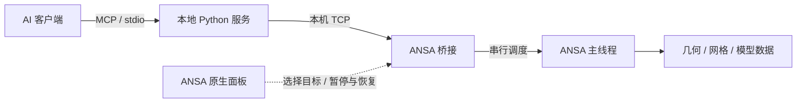

<p align="center">
  
</p>

<h1 align="center">ANSA MCP Plugin</h1>

<p align="center"><strong>让 AI 自动化完成 ANSA 前处理任务，执行可追踪，结果可核对。</strong></p>

<p align="center">
  
  
  
  <a href="LICENSE"></a>
</p>

<p align="center">
  <a href="#快速开始">快速开始</a> ·
  <a href="#可以做什么">核心能力</a> ·
  <a href="#ansa-原生控制面板">控制面板</a> ·
  <a href="docs/tools.md">完整工具映射</a> ·
  <a href="docs/acceptance.md">验收记录</a>
</p>

ANSA MCP Plugin 是面向 ANSA 的本地 [Model Context Protocol](https://modelcontextprotocol.io/) 集成。支持 MCP stdio 的 AI 客户端可以查询模型、执行受控建模与网格操作，并通过 ANSA 原生控制面板选择目标窗口、查看状态和暂停任务。

源码默认使用共享常驻后端：多个聊天通过各自的 stdio 前端复用同一连接与任务队列，关闭聊天不会停止其他会话的任务。后端重启后仍需在 ANSA 面板重新绑定；启动诊断与升级停止方式见[安装说明](docs/installation.md)。

工作源码新增的[关联范围与冻结](docs/reference/mesh-scope.md)、[已有边界编辑](docs/reference/perimeter-edit.md)及[已有面网格重划](docs/reference/surface-remesh.md)提供可组合的网格操作与回读；正式发行与安装状态见下方验收说明。

**当前工作源码注册 93 个 MCP 工具，以前处理任务自动化为核心。** 22 个结构化网格工具覆盖显式块规划、NASTRAN 网格审计、受控分割与直线扫掠、有限六面 CAD Map、Map Block 受控准备、显式caps设置、填充及状态回读、有限孔环源面准备、只读扫掠候选分类、几何特征读取、CONS 辅助曲线转换、尺寸/曲率分段、原始 CONS 分段读取与受控设置、多块合批准备、来源记录和证据分页。既有表面网格入口另支持保留整数 CONS 种子的原生四边映射模式。受限独立真机验收及未覆盖范围见[验收记录](docs/acceptance.md)，发行集成仍待完成；工具数量不代表全部场景已验收。

矩形多块路线支持一次原生MapBlock准备、保留已完成块的增量/合批填充、共享接口及完整外皮核验。外部Python客户端 `MapBlockJobClient` 可逐组保存检查点，并在回执丢失后查询原任务继续；当前范围与使用示例见[复杂实体网格流程](docs/reference/complex-solid-meshing.md#多块路线的当前落地)。有限孔环支持原生MapBlock源面→Freeze→Extrude，以及已有四块MapBlock直接填充；两条路线的适用范围与独立质量结果见[孔环路线](docs/reference/complex-solid-meshing.md#有限孔环直扫)。任意工业CAD自动分解仍未开放。

中心单孔矩形板的[参数化原生流程](docs/reference/plate-hole-workflow.md)固化孔周环带＋外围矩形分区、整数边分段、四边形面重划、Freeze、厚度caps及六面体填充。`plate_hole_script`通过现有MCP脚本入口调用，提供[示例参数](examples/meshing/plate-hole-o-grid.json)；不是新增工具名，也不把矩形板模板套用于任意工业局部域。

接口审计另支持可选 CAD FACE 成员模式：从原生宏取得网格归属后检查全部关联节点，保留未知归属和未覆盖边界。已完成隔离夹具的 0.1 节点偏移反例及 S25 局部孔壁只读检查；节点检查通过不代表连续 CAD 覆盖已证明，范围见[验收记录](docs/acceptance.md)。

相交工具新增 `entity_type="SOLID"`，支持两组各最多 200 个 NASTRAN CHEXA8/CPENTA6。独立试件已验证包容、共享节点和接触边界；S25 未解决候选经 60 批原生检查，检查前后全量 FE 指纹一致。该能力仍属于当前工作源码，部署状态见[验收记录](docs/acceptance.md)。

CAD 分割验收另有[参数化离线入口](docs/reference/structured-meshing.md#cad-分割完整性的离线复用)：用完整原始面清单、分片对应关系和文件哈希检查漏片、额外区域与重复区域。已验证 S25 全部 32 个原始面及独立带孔平面反例；该入口尚未注册为 MCP 工具，不会自动推导分块方案。

> **预览版本**：当前已验收环境为 Windows 11、ANSA 2026.1.0 GUI、64 位 CPython 3.12。当前为 `0.1.3` 预览版源码，尚未发布公开安装包；下方提供源码开发入口。版本变更见[更新记录](CHANGELOG.md)。

## 可以做什么

围绕“几何准备 → 网格划分 → 模型检查”的前处理流程，AI 客户端可以组合专用工具与 Python 脚本，自动化执行重复操作，并回读模型数据核对结果。

| 前处理环节 | 可以自动化完成的任务 |
| --- | --- |
| **几何查询与准备** | 首先检查多镜面、旋转/周期及轴对称特征，确认后优先选择半模型、1/4等最小代表域或扇区，完成后镜像或旋转复制；统计几何信息，按面积、位置和方向筛选目标面，预览候选与操作范围，为后续网格任务准备输入 |
| **网格划分与编辑** | 读取[关联范围并独立冻结/解冻](docs/reference/mesh-scope.md)，生成三角形、四边形表面网格，执行 TETRA RAPID 体网格与映射六面体网格划分；支持拉伸、独立镜像、节点合并及选定网格释放 |
| **结构化网格规划与审计** | 对调用方显式提供的 NASTRAN 块、接口和扫掠源面进行受限规划、拓扑/几何审计及可追踪的受控操作；不承诺任意复杂体自动分块 |
| **网格质量与模型检查** | 检查几何边界、网格质量、相交、穿透与刚性依赖，定位问题单元和关联实体，回读检查报告 |
| **模型组织与文件管理** | 查询与修改实体和属性，创建 Part、维护 SET 成员，读取模型摘要及 Include 信息，完成模型保存、重开与导入导出 |
| **脚本扩展与 API 查询** | 预检并执行自定义 Python 脚本，扩展前处理操作；查询本机 ANSA API 帮助，缺失时回退运行时说明 |
| **任务追踪与结果核对** | 跟踪任务状态、历史和日志，按任务或操作 ID 查询原结果；回读实体、属性与网格数据，核对自动化任务的执行情况 |

此外，还支持[连接定义与检查](docs/reference/operations.md#连接对象与连接实现)、[刚体与运动副配置、接触关系回读](docs/reference/abaqus.md)等专项场景。

新增[四类原生网格质量模板](docs/reference/mesh-quality.md)：线性壳、线性实体、显式碰撞壳、显式碰撞实体。ANSA 原生准则负责主检查与修复复查，MCP 保留问题定位、备份和位移／范围保护；阈值来自项目准则，deck 用于实体和算法适配。

Quality Inspector 对应工作流支持原生质量数值明细、Fix Quality 参数恢复、自动候选节点和累计位移受限的多轮修复。检查总单元数不设固定2000上限，支持整体范围分批检查及分页详情；修复范围和资源预算仍明确受控。当前提供源码预览版，尚未发布配套安装包。

当前版本已开放 LS-DYNA 原生显式模板的质量检查、按准则定位及 QUAD4／HEXA8 受控修复；其他 LS-DYNA 写操作继续关闭。实际支持条件及验证范围见[网格质量说明](docs/reference/mesh-quality.md)与[验收记录](docs/acceptance.md)。

结构化网格契约限定 NASTRAN 的线性 CQUAD4／CTRIA3 源面和 CHEXA8／CPENTA6 结果；分块计划来自调用方显式输入。`ansa_geometry_features` 分开检查原生 CONS 闭环与解析 CURVE；有界 IGES 支持 100 圆弧、110 直线及严格单段线性多项式 112，种子建议先与原生长度交叉核验。`ansa_geometry_boundary_prepare` 经备份逐条转换最多 32 CONS，并验证新增 CURVE 与指定空辅助 Part 的归属；转换可能产生近似样条，不证明原始边界解析等价，不自动生成 CONS 圆弧种子。初版限 NASTRAN 毫米、已有 Part 及已保存数据库；失败不隐式保存、重开或重试。完整契约见[结构化网格说明](docs/reference/structured-meshing.md)；[复杂实体网格复用流程](docs/reference/complex-solid-meshing.md)说明共享边分段、悬挂节点检查和兼容块合批。正式发行包集成仍待完成。

开发遵循[原生能力优先准则](docs/development.md#原生能力优先)：先查 ANSA 自带功能，再决定是否自研。CONS 转换复用原生 `ConsToCurves`，另用原生投影记录九点转换偏差；采样结果不作为连续 CAD 等价证明。

`ansa_mesh_seed_read` 与 `ansa_mesh_seed_apply` 将显式整数分段直接应用到原始 CONS，复用原生 `NumberPerimeters`，无需先转辅助曲线。只读查询避免实例化边界 GRID；写入经备份后核验真实点数、原生投影、CAD 导出指纹和原有节点保护。当前限定首次分段、未网格宏及毫米 NASTRAN 模型，详见[分段契约](docs/reference/structured-meshing.md#原生-cons-分段读取与写入)。

各项功能的 deck、网格类型、几何形状、实体范围与执行前置条件见[工具参考](docs/tools.md)及其专项契约。

## ANSA 原生控制面板

控制面板直接集成在 ANSA 中，可查看后端连接、任务接收状态和当前 AI 操作目标，在目标窗口主动连接或切换实例，并通过 **暂停任务 / 恢复任务** 控制任务接收与队列派发。

<p align="center">
  
</p>

<p align="center"><sub>ANSA 2026.1.0 中的原生控制面板，展示连接状态、任务控制与当前 AI 操作目标。</sub></p>

**概览、命令记录、诊断日志、设置**四个页签集中展示运行信息。概览按模型、AI 操作目标和任务状态分组；完整路径、进程及会话标识集中保留在诊断页，可通过“查看诊断详情”打开。已开始的调用会继续完成，“暂停任务”不会强制中断正在执行的任务。

## 从一句工程任务开始

以下示例围绕几何准备、网格生成、质量检查和重复任务自动化。实际执行前，需核对目标模型、deck、单位与实体范围，并补齐工具所需的参数与前置条件。

**网格划分与核对**

> 模型长度单位为 mm。请对指定的未网格面划分目标尺寸 10 mm 的表面网格，使用当前 deck 支持的单元类型；写入前保存备份，完成后回读单元数量、类型、边长和属性归属。

**网格质量检查**

> 请按当前会话的质量准则检查指定壳单元，汇总失败准则与问题单元 ID；检查指定两组壳单元之间的相交和穿透，给出检查范围、问题清单及未能判断的部分。

**重复任务自动化**

> 请按我提供的实体清单和属性对应表，批量核对属性归属并汇总差异；优先组合专用工具，需要脚本时先查询本机 ANSA API 帮助并预检，执行后给出任务 ID、检查结果和未完成项。

## 工作方式



- **明确目标**：从目标 ANSA 面板主动连接，执行前核对实例、会话及模型代次。
- **在主线程执行**：ANSA API 由所属 ANSA 主线程调用，模型写入按队列串行执行。
- **结果可追踪**：写操作使用操作 ID；超时后可查询原任务及执行记录，再决定下一步。
- **可独立核对**：返回卡片、实体和关系数据；保存重开、独立回读和画布观察分别记录。

生产通信使用自研本机 TCP。

## 快速开始

需要同时安装**外部 MCP 服务**和 **ANSA 插件面板**。以下为当前预览版的源码安装流程。

### 让 AI 协助安装

将下面整段指令发给能够读取本机文件、执行终端命令的 AI 助手；也可以在已下载的源码目录中打开 AI 编程助手后直接粘贴。普通聊天助手可以指导你逐步操作。

```text
请帮我安装并配置 ANSA MCP Plugin，仓库地址为 https://github.com/Huangcsu/ansa-mcp-plugin。先阅读仓库中的 README.md 和 docs/installation.md，检查 Windows、64 位 CPython 3.12、ANSA 2026.1.0，并确认我要使用的 MCP 客户端；缺少安装条件或客户端信息时先向我确认。按文档获取源码，安装外部 MCP 服务和 ANSA 插件面板，备份并保留客户端原有配置，只新增或更新本项目的 MCP 条目，两端使用安装器输出的同一个私有 runtime_home。需要退出 ANSA 时，先让我保存模型并退出；需要重启客户端、打开面板或点击连接时，给出具体操作步骤。完成后检查 MCP 工具发现和面板绑定，调用 ansa_connection_status，再用返回的最新目标上下文调用 ansa_model_snapshot 做只读验证。安装验证期间保留当前模型，不执行建模、删除或覆盖操作。最后分别报告已安装、已配置、已连接和模型回读的实际结果，以及仍需我完成的步骤。
```

下面是手动安装步骤。安装完成后，可按第 5 步检查是否连通。

### 0. 获取源码并检查环境

使用 Git 下载源码并进入项目目录：

```powershell
git clone https://github.com/Huangcsu/ansa-mcp-plugin.git
Set-Location ansa-mcp-plugin
```

也可以[下载源码 ZIP](https://github.com/Huangcsu/ansa-mcp-plugin/archive/refs/heads/main.zip)，解压后在包含 `pyproject.toml`、`scripts/` 和 `packaging/` 的**源码根目录**打开 PowerShell。源码目录需长期保留，供开发入口加载。

确认已安装 **64 位 CPython 3.12**、拥有可用许可证的 **ANSA 2026.1.0 GUI**，并准备一个支持本机 MCP stdio 服务的客户端。Python 命令在外部 PowerShell 中执行。

### 1. 准备外部 Python 环境

在源码根目录执行：

```powershell
py -3.12 -m venv .venv
.\.venv\Scripts\python.exe -m pip install -r packaging/requirements-runtime.lock
.\.venv\Scripts\python.exe -m pip install -e . --no-deps
.\.venv\Scripts\python.exe -m pip check
.\.venv\Scripts\python.exe -m ansa_mcp_plugin --help
```

`pip check` 应报告依赖无冲突，最后一条命令应显示 `--runtime-home` 参数。若 `py` 命令不可用，可用已安装的 64 位 Python 3.12 解释器绝对路径创建虚拟环境。

### 2. 安装并启用 ANSA 插件面板

首次使用时，先用 ANSA 的 **default profile** 启动一次，保存 ANSA GUI Settings，确保已生成该 profile 的 GUI 配置。保存当前模型并关闭 ANSA；若已有 MCP 后端使用同一运行目录，也先停止该后端。在源码根目录执行：

```powershell
.\.venv\Scripts\python.exe scripts/install_dev_plugin.py --enable
```

该命令会备份当前用户 ANSA **default profile** 的 GUI 配置和已有开发入口，安装 `.ppl` 插件描述、入口脚本、图标及开发配置，并通过 `--enable` 启用插件。安装位置为 `%USERPROFILE%/.BETA/version_26.10.000/ANSA/plugins/`；输出中的 `registration_enabled=true` 表示已启用登记。

1. 重新启动 ANSA 2026.1.0，使用上述 **default profile**。
2. 在 Ribbon 的 **Custom → Plugins** 中点击 **ANSA MCP Plugin → 控制面板**。
3. 确认面板出现，包含**概览、命令记录、诊断日志、设置**页签。首次点击入口会启动本机桥接；外部 MCP 服务启动后，再按第 4 步连接。

记录安装器输出的 `runtime_home`，客户端需使用同一路径。插件入口未出现时，按[面板安装排查](docs/installation.md#面板入口未出现)检查 profile 与启用状态。

源码安装依赖当前仓库路径，移动源码目录后需重新运行安装器。配套 wheel 与官方 `.bpkg` 的独立安装、构建和回退流程见[安装说明](docs/installation.md)。

### 3. 配置 MCP 客户端

将下面示例加入支持 MCP stdio 的客户端配置，并将 **两个占位符替换为实际绝对路径**。`runtime-home` 使用上一步安装器输出的 `runtime_home`，默认是当前用户目录下的 `ANSA-MCP-Plugin-Runtime/development`。JSON 中的占位符不会自动展开。

`command` 填第 1 步创建的 `.venv/Scripts/python.exe` 完整路径；JSON 中的 Windows 路径可使用 `/` 或转义后的 `\\`。合并到客户端已有 MCP 配置中，保留其他服务；客户端使用其他配置格式时，填写对应的启动命令与参数。

```json
{
  "mcpServers": {
    "ansa": {
      "command": "<ABSOLUTE_PATH_TO_VENV_PYTHON>",
      "args": [
        "-m", "ansa_mcp_plugin",
        "--runtime-home", "<ABSOLUTE_PATH_TO_PRIVATE_RUNTIME>"
      ]
    }
  }
}
```

各客户端的配置文件位置和格式可能不同。保存后按客户端要求重新加载 MCP 配置，必要时重启客户端或新建对话。服务由客户端启动，同一 `runtime_home` 只使用一个后端。独立安装器会生成匹配安装位置的 `mcp-config.json`。

### 4. 从 ANSA 面板连接

1. 在 MCP 客户端加载上一步配置，启动外部服务。
2. 在目标 ANSA 中打开所需模型，再从 **Custom → Plugins → ANSA MCP Plugin → 控制面板** 打开面板。
3. 点击 **连接此窗口**，确认概览中的模型、求解器及 AI 操作目标；完整路径和实例标识可在诊断页核对。
4. 通过 `ansa_connection_status` 和 `ansa_model_snapshot` 核对活动目标，再开始明确范围的建模任务。

后端与桥接认证连接成功后会自动读取模型状态，无需先让 AI 调用查询工具。面板会区分“正在读取”“等待响应”和“已识别”；自动读取不会授权 AI，仍需点击连接。ANSA 忙碌时，读取请求会等待主线程处理，不会因等待超时反复排队；执行错误最多尝试三次。面板中的模型信息是带读取时间的快照，任务执行前仍会重新校验。

独立原生包的菜单名为 **ANSA MCP Plugin → Control Panel**。面板中的 **暂停任务 / 恢复任务** 控制任务接收与队列派发，已开始的调用继续完成；插件入口中的**停止桥接**（独立包为 **Stop Bridge**）用于关闭空闲桥接。

### 5. 确认安装与连接

满足以下条件后，即可开始使用：

- **客户端已加载工具**：工具数取决于正在运行的开发源码或安装版本；本仓库当前工作源码注册 91 个，至少应包含 `ansa_connection_status` 和 `ansa_model_snapshot`。新增结构化网格与几何特征工具的验收范围见验收记录，发行集成仍待完成。
- **面板已连接目标**：后端在线、任务可受理，AI 目标为当前 ANSA 实例。
- **模型可读取**：连接状态与模型快照均返回成功，目标进程、模型路径和 deck 与当前窗口一致。

可将下面这句话发给已配置好 MCP 的 AI 客户端：

> 请检查 ANSA MCP Plugin 是否连通：先调用 ansa_connection_status，使用返回的最新目标上下文调用 ansa_model_snapshot；只读取并报告目标进程、模型路径、deck 和连接结果，保留当前模型，不执行建模、删除或覆盖操作。

当前模型尚未保存时，路径可能为空。若没有活动目标，先回到目标 ANSA 面板点击**连接此窗口**；面板后端离线时，核对客户端服务启动情况及两端 `runtime_home`。其他问题见[安装排查](docs/installation.md#面板入口未出现)。

## 文档导航

| 文档 | 内容 |
| --- | --- |
| [安装与回退](docs/installation.md) | 外部 wheel、原生包、运行配置与版本切换 |
| [架构说明](docs/architecture.md) | 包职责、主线程、目标与模型身份、持久任务 |
| [工具参考](docs/tools.md) | 91 个工作源码接口及分类契约 |
| [结构化网格](docs/reference/structured-meshing.md) | 22 个 NASTRAN 结构化网格工具的限制与契约 |
| [复杂实体网格复用流程](docs/reference/complex-solid-meshing.md) | 特征分块、整数分段、共享源面、合批与失败恢复 |
| [开发说明](docs/development.md) | 环境、源码目录、构建和验证入口 |
| [验证范围](docs/acceptance.md) | 当前回归、既有真机证据与已知限制 |
| [发布说明](docs/releasing.md) | 源码边界、配套产物与发布步骤 |

## 参与开发

欢迎提供可复现的问题与使用反馈。报告问题时，请附 ANSA 版本、deck、工具名、操作 / 任务 ID 和复现步骤。开发环境与验证方式见[开发说明](docs/development.md)。

作者：[Huangcsu](https://github.com/Huangcsu)。项目仓库：[Huangcsu/ansa-mcp-plugin](https://github.com/Huangcsu/ansa-mcp-plugin)；问题与建议请提交至 [Issues](https://github.com/Huangcsu/ansa-mcp-plugin/issues)。

## 致谢

本项目在早期调研与开发中参考了以下项目：

- [RufengLai/ansa-api-mcp](https://github.com/RufengLai/ansa-api-mcp)：ANSA Python API 文档检索与 MCP 集成思路。
- [QingMuNan1991/ansa-mcp-sum](https://github.com/QingMuNan1991/ansa-mcp-sum)：ANSA GUI 内的 MCP 桥接流程、工具组织与脚本执行设计。

感谢上述项目的作者与贡献者分享实践，为本项目的前处理任务自动化提供参考。

## 许可证

本项目代码采用 [MIT License](LICENSE)。第三方依赖与 ANSA 的许可分别适用；使用本插件需要自行具备有效的 ANSA 使用授权。本项目是第三方集成。
