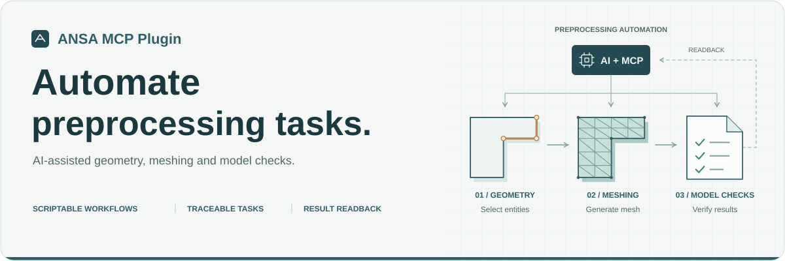
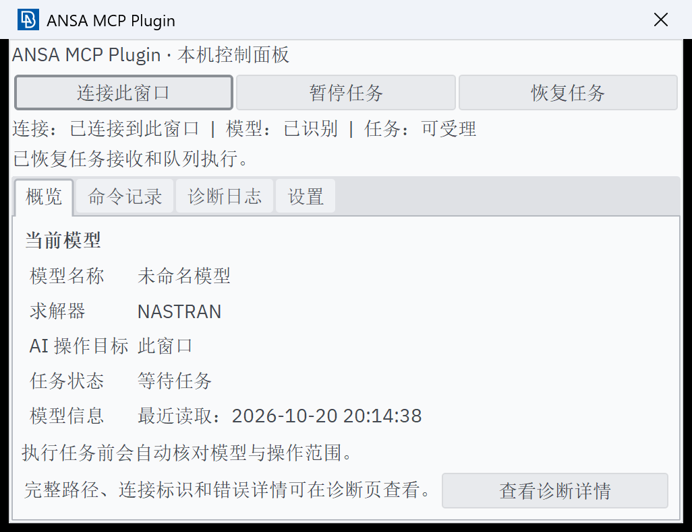
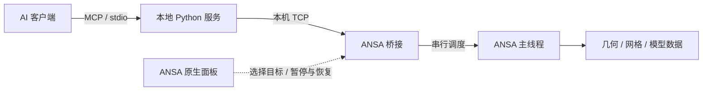

<p align="center">
  
</p>

<h1 align="center">ANSA MCP Plugin</h1>

<p align="center"><strong>让 AI 自动化完成 ANSA 前处理任务，执行可追踪，结果可核对。</strong></p>

<p align="center">
  
  
  
  <a href="LICENSE"></a>
</p>

<p align="center">
  <a href="#快速开始">快速开始</a> ·
  <a href="#可以做什么">核心能力</a> ·
  <a href="#ansa-原生控制面板">控制面板</a> ·
  <a href="docs/tools.md">完整工具映射</a> ·
  <a href="docs/acceptance.md">验收记录</a>
</p>

ANSA MCP Plugin 是面向 ANSA 的本地 [Model Context Protocol](https://modelcontextprotocol.io/) 集成。支持 MCP stdio 的 AI 客户端可以查询模型、执行受控建模与网格操作，并通过 ANSA 原生控制面板选择目标窗口、查看状态和暂停任务。

**当前提供 65 个 MCP 工具，以前处理任务的自动化为核心。** 支持几何查询与筛选、表面与体网格生成、网格质量检查以及实体与属性管理；结合脚本扩展、任务追踪和结果回读，让 AI 能够串联这些操作，减少重复性前处理工作，并保留可核对的执行结果。

> **预览版本**：当前已验收环境为 Windows 11、ANSA 2026.1.0 GUI、64 位 CPython 3.12。当前为 `0.1.1` 预览版源码，尚未发布公开安装包；下方提供源码开发入口。版本变更见[更新记录](CHANGELOG.md)。

## 可以做什么

围绕“几何准备 → 网格划分 → 模型检查”的前处理流程，AI 客户端可以组合专用工具与 Python 脚本，自动化执行重复操作，并回读模型数据核对结果。

| 前处理环节 | 可以自动化完成的任务 |
| --- | --- |
| **几何查询与准备** | 统计几何信息，按面积、位置和方向筛选目标面，预览候选与操作范围，为后续网格任务准备输入 |
| **网格划分与编辑** | 生成三角形、四边形表面网格，执行 TETRA RAPID 体网格与映射六面体网格划分；支持拉伸、独立镜像、节点合并及选定网格释放 |
| **网格质量与模型检查** | 检查几何边界、网格质量、相交、穿透与刚性依赖，定位问题单元和关联实体，回读检查报告 |
| **模型组织与文件管理** | 查询与修改实体和属性，创建 Part、维护 SET 成员，读取模型摘要及 Include 信息，完成模型保存、重开与导入导出 |
| **脚本扩展与 API 查询** | 预检并执行自定义 Python 脚本，扩展前处理操作；查询本机 ANSA API 帮助，缺失时回退运行时说明 |
| **任务追踪与结果核对** | 跟踪任务状态、历史和日志，按任务或操作 ID 查询原结果；回读实体、属性与网格数据，核对自动化任务的执行情况 |

此外，还支持[连接定义与检查](docs/reference/operations.md#连接对象与连接实现)、[刚体与运动副配置、接触关系回读](docs/reference/abaqus.md)等专项场景。

各项功能的 deck、网格类型、几何形状、实体范围与执行前置条件见[工具参考](docs/tools.md)及其专项契约。

## ANSA 原生控制面板

控制面板直接集成在 ANSA 中，可查看后端连接、任务接收状态和当前 AI 操作目标，在目标窗口主动连接或切换实例，并通过 **暂停任务 / 恢复任务** 控制任务接收与队列派发。

<p align="center">
  
</p>

<p align="center"><sub>ANSA 2026.1.0 中的原生控制面板，展示连接状态、任务控制与当前 AI 操作目标。</sub></p>

**概览、命令记录、诊断日志、设置**四个页签集中展示运行信息。概览按模型、AI 操作目标和任务状态分组；完整路径、进程及会话标识集中保留在诊断页，可通过“查看诊断详情”打开。已开始的调用会继续完成，“暂停任务”不会强制中断正在执行的任务。

## 从一句工程任务开始

以下示例围绕几何准备、网格生成、质量检查和重复任务自动化。实际执行前，需核对目标模型、deck、单位与实体范围，并补齐工具所需的参数与前置条件。

**网格划分与核对**

> 模型长度单位为 mm。请对指定的未网格面划分目标尺寸 10 mm 的表面网格，使用当前 deck 支持的单元类型；写入前保存备份，完成后回读单元数量、类型、边长和属性归属。

**网格质量检查**

> 请按当前会话的质量准则检查指定壳单元，汇总失败准则与问题单元 ID；检查指定两组壳单元之间的相交和穿透，给出检查范围、问题清单及未能判断的部分。

**重复任务自动化**

> 请按我提供的实体清单和属性对应表，批量核对属性归属并汇总差异；优先组合专用工具，需要脚本时先查询本机 ANSA API 帮助并预检，执行后给出任务 ID、检查结果和未完成项。

## 工作方式



- **明确目标**：从目标 ANSA 面板主动连接，执行前核对实例、会话及模型代次。
- **在主线程执行**：ANSA API 由所属 ANSA 主线程调用，模型写入按队列串行执行。
- **结果可追踪**：写操作使用操作 ID；超时后可查询原任务及执行记录，再决定下一步。
- **可独立核对**：返回卡片、实体和关系数据；保存重开、独立回读和画布观察分别记录。

生产通信使用自研本机 TCP。

## 快速开始

需要同时安装**外部 MCP 服务**和 **ANSA 插件面板**。以下为当前预览版的源码安装流程。

### 让 AI 协助安装

将下面整段指令发给能够读取本机文件、执行终端命令的 AI 助手；也可以在已下载的源码目录中打开 AI 编程助手后直接粘贴。普通聊天助手可以指导你逐步操作。

```text
请帮我安装并配置 ANSA MCP Plugin，仓库地址为 https://github.com/Huangcsu/ansa-mcp-plugin。先阅读仓库中的 README.md 和 docs/installation.md，检查 Windows、64 位 CPython 3.12、ANSA 2026.1.0，并确认我要使用的 MCP 客户端；缺少安装条件或客户端信息时先向我确认。按文档获取源码，安装外部 MCP 服务和 ANSA 插件面板，备份并保留客户端原有配置，只新增或更新本项目的 MCP 条目，两端使用安装器输出的同一个私有 runtime_home。需要退出 ANSA 时，先让我保存模型并退出；需要重启客户端、打开面板或点击连接时，给出具体操作步骤。完成后检查 MCP 工具发现和面板绑定，调用 ansa_connection_status，再用返回的最新目标上下文调用 ansa_model_snapshot 做只读验证。安装验证期间保留当前模型，不执行建模、删除或覆盖操作。最后分别报告已安装、已配置、已连接和模型回读的实际结果，以及仍需我完成的步骤。
```

下面是手动安装步骤。安装完成后，可按第 5 步检查是否连通。

### 0. 获取源码并检查环境

使用 Git 下载源码并进入项目目录：

```powershell
git clone https://github.com/Huangcsu/ansa-mcp-plugin.git
Set-Location ansa-mcp-plugin
```

也可以[下载源码 ZIP](https://github.com/Huangcsu/ansa-mcp-plugin/archive/refs/heads/main.zip)，解压后在包含 `pyproject.toml`、`scripts/` 和 `packaging/` 的**源码根目录**打开 PowerShell。源码目录需长期保留，供开发入口加载。

确认已安装 **64 位 CPython 3.12**、拥有可用许可证的 **ANSA 2026.1.0 GUI**，并准备一个支持本机 MCP stdio 服务的客户端。Python 命令在外部 PowerShell 中执行。

### 1. 准备外部 Python 环境

在源码根目录执行：

```powershell
py -3.12 -m venv .venv
.\.venv\Scripts\python.exe -m pip install -r packaging/requirements-runtime.lock
.\.venv\Scripts\python.exe -m pip install -e . --no-deps
.\.venv\Scripts\python.exe -m pip check
.\.venv\Scripts\python.exe -m ansa_mcp_plugin --help
```

`pip check` 应报告依赖无冲突，最后一条命令应显示 `--runtime-home` 参数。若 `py` 命令不可用，可用已安装的 64 位 Python 3.12 解释器绝对路径创建虚拟环境。

### 2. 安装并启用 ANSA 插件面板

首次使用时，先用 ANSA 的 **default profile** 启动一次，保存 ANSA GUI Settings，确保已生成该 profile 的 GUI 配置。保存当前模型并关闭 ANSA；若已有 MCP 后端使用同一运行目录，也先停止该后端。在源码根目录执行：

```powershell
.\.venv\Scripts\python.exe scripts/install_dev_plugin.py --enable
```

该命令会备份当前用户 ANSA **default profile** 的 GUI 配置和已有开发入口，安装 `.ppl` 插件描述、入口脚本、图标及开发配置，并通过 `--enable` 启用插件。安装位置为 `%USERPROFILE%/.BETA/version_26.10.000/ANSA/plugins/`；输出中的 `registration_enabled=true` 表示已启用登记。

1. 重新启动 ANSA 2026.1.0，使用上述 **default profile**。
2. 在 Ribbon 的 **Custom → Plugins** 中点击 **ANSA MCP Plugin → 控制面板**。
3. 确认面板出现，包含**概览、命令记录、诊断日志、设置**页签。首次点击入口会启动本机桥接；外部 MCP 服务启动后，再按第 4 步连接。

记录安装器输出的 `runtime_home`，客户端需使用同一路径。插件入口未出现时，按[面板安装排查](docs/installation.md#面板入口未出现)检查 profile 与启用状态。

源码安装依赖当前仓库路径，移动源码目录后需重新运行安装器。配套 wheel 与官方 `.bpkg` 的独立安装、构建和回退流程见[安装说明](docs/installation.md)。

### 3. 配置 MCP 客户端

将下面示例加入支持 MCP stdio 的客户端配置，并将 **两个占位符替换为实际绝对路径**。`runtime-home` 使用上一步安装器输出的 `runtime_home`，默认是当前用户目录下的 `ANSA-MCP-Plugin-Runtime/development`。JSON 中的占位符不会自动展开。

`command` 填第 1 步创建的 `.venv/Scripts/python.exe` 完整路径；JSON 中的 Windows 路径可使用 `/` 或转义后的 `\\`。合并到客户端已有 MCP 配置中，保留其他服务；客户端使用其他配置格式时，填写对应的启动命令与参数。

```json
{
  "mcpServers": {
    "ansa": {
      "command": "<ABSOLUTE_PATH_TO_VENV_PYTHON>",
      "args": [
        "-m", "ansa_mcp_plugin",
        "--runtime-home", "<ABSOLUTE_PATH_TO_PRIVATE_RUNTIME>"
      ]
    }
  }
}
```

各客户端的配置文件位置和格式可能不同。保存后按客户端要求重新加载 MCP 配置，必要时重启客户端或新建对话。服务由客户端启动，同一 `runtime_home` 只使用一个后端。独立安装器会生成匹配安装位置的 `mcp-config.json`。

### 4. 从 ANSA 面板连接

1. 在 MCP 客户端加载上一步配置，启动外部服务。
2. 在目标 ANSA 中打开所需模型，再从 **Custom → Plugins → ANSA MCP Plugin → 控制面板** 打开面板。
3. 点击 **连接此窗口**，确认概览中的模型、求解器及 AI 操作目标；完整路径和实例标识可在诊断页核对。
4. 通过 `ansa_connection_status` 和 `ansa_model_snapshot` 核对活动目标，再开始明确范围的建模任务。

后端与桥接认证连接成功后会自动读取模型状态，无需先让 AI 调用查询工具。面板会区分“正在读取”“等待响应”和“已识别”；自动读取不会授权 AI，仍需点击连接。ANSA 忙碌时，读取请求会等待主线程处理，不会因等待超时反复排队；执行错误最多尝试三次。面板中的模型信息是带读取时间的快照，任务执行前仍会重新校验。

独立原生包的菜单名为 **ANSA MCP Plugin → Control Panel**。面板中的 **暂停任务 / 恢复任务** 控制任务接收与队列派发，已开始的调用继续完成；插件入口中的**停止桥接**（独立包为 **Stop Bridge**）用于关闭空闲桥接。

### 5. 确认安装与连接

满足以下条件后，即可开始使用：

- **客户端已加载工具**：当前版本可发现 65 个工具，至少应包含 `ansa_connection_status` 和 `ansa_model_snapshot`。
- **面板已连接目标**：后端在线、任务可受理，AI 目标为当前 ANSA 实例。
- **模型可读取**：连接状态与模型快照均返回成功，目标进程、模型路径和 deck 与当前窗口一致。

可将下面这句话发给已配置好 MCP 的 AI 客户端：

> 请检查 ANSA MCP Plugin 是否连通：先调用 ansa_connection_status，使用返回的最新目标上下文调用 ansa_model_snapshot；只读取并报告目标进程、模型路径、deck 和连接结果，保留当前模型，不执行建模、删除或覆盖操作。

当前模型尚未保存时，路径可能为空。若没有活动目标，先回到目标 ANSA 面板点击**连接此窗口**；面板后端离线时，核对客户端服务启动情况及两端 `runtime_home`。其他问题见[安装排查](docs/installation.md#面板入口未出现)。

## 文档导航

| 文档 | 内容 |
| --- | --- |
| [安装与回退](docs/installation.md) | 外部 wheel、原生包、运行配置与版本切换 |
| [架构说明](docs/architecture.md) | 包职责、主线程、目标与模型身份、持久任务 |
| [工具参考](docs/tools.md) | 65 个接口及分类契约 |
| [开发说明](docs/development.md) | 环境、源码目录、构建和验证入口 |
| [验证范围](docs/acceptance.md) | 当前回归、既有真机证据与已知限制 |
| [发布说明](docs/releasing.md) | 源码边界、配套产物与发布步骤 |

## 参与开发

欢迎提供可复现的问题与使用反馈。报告问题时，请附 ANSA 版本、deck、工具名、操作 / 任务 ID 和复现步骤。开发环境与验证方式见[开发说明](docs/development.md)。

作者：[Huangcsu](https://github.com/Huangcsu)。项目仓库：[Huangcsu/ansa-mcp-plugin](https://github.com/Huangcsu/ansa-mcp-plugin)；问题与建议请提交至 [Issues](https://github.com/Huangcsu/ansa-mcp-plugin/issues)。

## 致谢

本项目在早期调研与开发中参考了以下项目：

- [RufengLai/ansa-api-mcp](https://github.com/RufengLai/ansa-api-mcp)：ANSA Python API 文档检索与 MCP 集成思路。
- [QingMuNan1991/ansa-mcp-sum](https://github.com/QingMuNan1991/ansa-mcp-sum)：ANSA GUI 内的 MCP 桥接流程、工具组织与脚本执行设计。

感谢上述项目的作者与贡献者分享实践，为本项目的前处理任务自动化提供参考。

## 许可证

本项目代码采用 [MIT License](LICENSE)。第三方依赖与 ANSA 的许可分别适用；使用本插件需要自行具备有效的 ANSA 使用授权。本项目是第三方集成。
