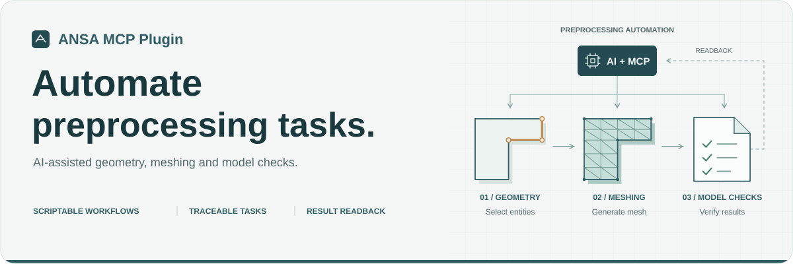
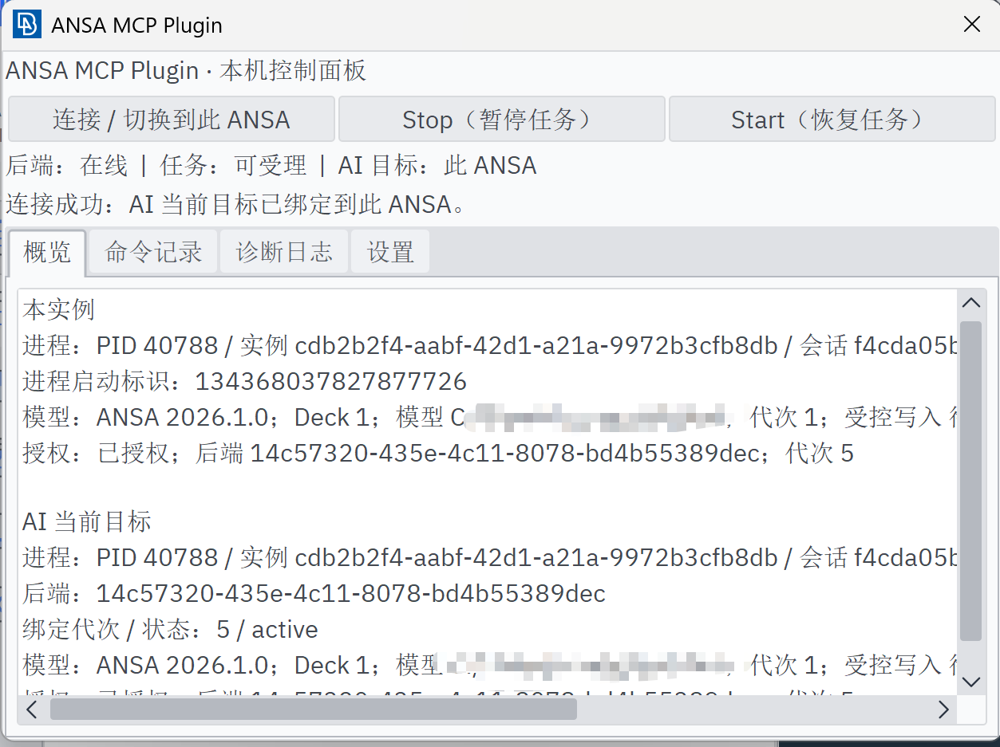

<p align="center">
  
</p>

<h1 align="center">ANSA MCP Plugin</h1>

<p align="center"><strong>用自然语言组织 ANSA 前处理，让操作可追踪、结果可核对。</strong></p>

<p align="center">
  
  
  
  <a href="LICENSE"></a>
</p>

<p align="center">
  <a href="#可以做什么">核心能力</a> ·
  <a href="#快速开始">快速开始</a> ·
  <a href="#使用示例">使用示例</a> ·
  <a href="docs/tools.md">工具参考</a> ·
  <a href="#文档导航">文档导航</a>
</p>

ANSA MCP Plugin 将 AI 客户端与本机 ANSA 连接起来。通过 [Model Context Protocol（MCP）](https://modelcontextprotocol.io/)，AI 可以读取模型、调用 ANSA 原生功能，并将几何准备、网格划分和模型检查组织成连续的工作流程。

你可以向 AI 描述任务、指定模型范围和工程参数，在 ANSA 中查看执行结果。插件提供专用工具、Python 脚本入口和原生控制面板，支持从一次模型查询到多步前处理任务的自动化。

> 当前为 **0.1.3 源码预览版**，通过下方源码流程安装；配套正式安装包尚未发布。版本变化见[更新记录](CHANGELOG.md)，已验证的环境与功能范围见[验证说明](docs/acceptance.md)。

## 可以做什么

| 场景 | 主要能力 |
| --- | --- |
| **几何准备** | 查询几何特征，按面积、位置和方向筛选面，预览操作范围，执行显式平面切分与边界分段 |
| **网格划分与编辑** | 生成或重划表面网格，划分四面体与映射六面体网格，组织 MapBlock 与扫掠操作，冻结网格、镜像及合并节点 |
| **质量检查与修复** | 按线性／显式、壳／实体模板执行原生质量检查，定位问题单元，执行范围和节点位移受控的修复，检查相交与穿透 |
| **模型管理** | 查询和编辑实体、属性及 Part / SET，读取模型摘要与 Include 信息，保存、重开及导入导出模型 |
| **脚本与 API** | 查询本机 ANSA Python API 帮助，预检并执行脚本，将已有操作组合为可复用流程 |
| **任务追踪** | 查询任务状态、命令记录与日志，按任务或操作 ID 查找执行结果，回读模型数据核对变化 |

结构化网格流程以调用方明确提供的分块与接口为基础，由 AI 组织工程方案，工具负责具体操作与回读。各项能力的 deck、单元类型和适用范围见[工具参考](docs/tools.md)；连接、机构与接触等专项功能也可从该页查找。

## ANSA 原生控制面板

在 ANSA 中选择 AI 操作的目标窗口，查看连接与模型状态、命令记录和诊断日志，并随时暂停或恢复后续任务。

<p align="center">
  
</p>

模型操作在所属 ANSA 主线程串行执行。**暂停任务**会停止接收和派发后续任务，已经开始的调用会继续完成；遇到超时或断线，应先查询原任务状态，再决定下一步。

## 快速开始

已验证环境为 **Windows 11、ANSA 2026.1.0 GUI 和 64 位 CPython 3.12**。你需要有效的 ANSA 许可证，以及支持本机 MCP stdio 服务的 AI 客户端。

安装分为两部分：外部 Python 服务供 AI 客户端调用，ANSA 插件面板负责连接目标窗口。两端使用同一个私有运行目录 `runtime_home`。

<details>
<summary>让 AI 协助安装</summary>

将下面指令交给能读取本机文件并执行终端命令的 AI 助手：

```text
请帮我安装 ANSA MCP Plugin：https://github.com/Huangcsu/ansa-mcp-plugin。先读 README.md 和 docs/installation.md，检查环境并确认我要使用的 MCP 客户端。按文档安装外部服务和 ANSA 面板，备份并保留客户端原有配置，两端使用安装器输出的同一个 runtime_home。需要关闭 ANSA 时先让我保存模型并退出。安装后检查工具加载和面板绑定，调用 ansa_connection_status，再用最新目标上下文调用 ansa_model_snapshot 做只读验证。报告实际完成情况和仍需我操作的步骤。
```

</details>

### 1. 获取源码并准备 Python 环境

在 PowerShell 中执行：

```powershell
git clone https://github.com/Huangcsu/ansa-mcp-plugin.git
Set-Location ansa-mcp-plugin
py -3.12 -m venv .venv
.\.venv\Scripts\python.exe -m pip install -r packaging/requirements-runtime.lock
.\.venv\Scripts\python.exe -m pip install -e . --no-deps
.\.venv\Scripts\python.exe -m pip check
```

也可以[下载源码 ZIP](https://github.com/Huangcsu/ansa-mcp-plugin/archive/refs/heads/main.zip)，解压后在源码根目录执行 Python 环境安装命令。`pip check` 应报告依赖无冲突；若 `py` 不可用，可用 Python 3.12 解释器的绝对路径创建虚拟环境。

### 2. 安装 ANSA 插件面板

首次安装前，使用 ANSA 的 **default profile** 启动并保存一次 ANSA GUI Settings。保存模型并关闭 ANSA；若已有安装，先按[安装说明](docs/installation.md#面板入口未出现)停止使用同一运行目录的后端。然后在源码根目录执行：

```powershell
.\.venv\Scripts\python.exe scripts/install_dev_plugin.py --enable
```

安装器会备份已有开发入口和 default profile 的 GUI 配置，再安装并启用插件。记录输出的 **`runtime_home`**，下一步配置客户端时需要使用。

源码安装依赖当前仓库路径，请保留源码目录；移动目录后需重新运行安装器。

### 3. 配置 MCP 客户端

将下面条目合并到客户端已有 MCP 配置中，保留其他服务。把两个占位符替换为实际绝对路径：

- `command`：第 1 步创建的 `.venv/Scripts/python.exe`。
- `--runtime-home`：第 2 步安装器输出的 `runtime_home`。

```json
{
  "mcpServers": {
    "ansa": {
      "command": "<ABSOLUTE_PATH_TO_VENV_PYTHON>",
      "args": [
        "-m", "ansa_mcp_plugin",
        "--runtime-home", "<ABSOLUTE_PATH_TO_PRIVATE_RUNTIME>"
      ]
    }
  }
}
```

Windows 路径可使用 `/` 或转义后的 `\\`；占位符不会自动展开。各客户端的配置位置与格式不同，按客户端要求保存并重新加载 MCP 服务。

### 4. 连接目标模型

1. 启动已配置的 MCP 服务。
2. 重新打开 ANSA，使用 **default profile**，打开要操作的模型。
3. 从 **Custom → Plugins → ANSA MCP Plugin → 控制面板** 打开面板。
4. 点击 **连接此窗口**，核对面板中的模型、deck 和 AI 操作目标。

向 AI 发送下面的指令，完成首次连接验证：

> 请调用 ansa_connection_status，再使用返回的最新目标上下文调用 ansa_model_snapshot。只读取并报告当前目标进程、模型路径和 deck，确认与 ANSA 窗口一致。

客户端能加载工具、面板显示目标已连接、模型快照与当前窗口一致后，即可开始使用。面板入口未出现或后端离线时，参阅[安装排查](docs/installation.md#面板入口未出现)；独立安装、升级与回退也见[安装说明](docs/installation.md)。

## 使用示例

描述任务时，给出目标实体、单位与工程参数，便于 AI 选择工具并核对结果。

**了解模型**

> 请汇总当前模型的 Part、节点和单元数量，列出指定 Part 的属性归属与包围盒，全程只读。

**划分表面网格**

> 模型单位为 mm。请对指定的未网格面划分目标尺寸 10 mm 的表面网格，使用当前 deck 支持的单元类型。写入前保存备份，完成后回读单元数量、类型、边长和属性归属。

**检查网格质量**

> 请按我提供的项目质量准则检查指定壳单元，汇总失败准则与问题单元 ID，并在 ANSA 中定位问题。先给出检查结果，保留当前网格。

## 文档导航

| 文档 | 何时查阅 |
| --- | --- |
| [安装与回退](docs/installation.md) | 安装、连接排查、升级或切换版本 |
| [工具参考](docs/tools.md) | 查找可用工具、参数与适用范围 |
| [网格质量](docs/reference/mesh-quality.md) | 配置质量模板、定位问题与受控修复 |
| [结构化网格](docs/reference/structured-meshing.md) | 查阅分块、边分段、映射与扫掠的接口契约 |
| [复杂实体网格流程](docs/reference/complex-solid-meshing.md) | 组织分块方案、共享接口和多步网格任务 |
| [架构说明](docs/architecture.md) | 了解客户端、共享后端与 ANSA 桥接的协作方式 |
| [开发说明](docs/development.md) | 搭建开发环境、扩展工具与选择验证入口 |
| [验证范围](docs/acceptance.md) · [更新记录](CHANGELOG.md) | 核对已验证能力、已知限制与版本变化 |
| [发布说明](docs/releasing.md) | 构建与检查配套发行产物 |

## 反馈与参与

欢迎通过 [Issues](https://github.com/Huangcsu/ansa-mcp-plugin/issues) 报告问题或提出建议。反馈时请附 ANSA 版本、deck、工具名、操作／任务 ID 和复现步骤。开发与验证方式见[开发说明](docs/development.md)。

作者：[Huangcsu](https://github.com/Huangcsu)。

## 致谢

本项目在早期调研与开发中参考了：

- [RufengLai/ansa-api-mcp](https://github.com/RufengLai/ansa-api-mcp)：ANSA Python API 文档检索与 MCP 集成思路。
- [QingMuNan1991/ansa-mcp-sum](https://github.com/QingMuNan1991/ansa-mcp-sum)：ANSA GUI 内的 MCP 桥接流程、工具组织与脚本执行设计。

感谢上述项目作者与贡献者分享实践。

## 许可证

本项目代码采用 [MIT License](LICENSE)，是 ANSA 的第三方集成。第三方依赖与 ANSA 的许可分别适用，使用本插件需具备有效的 ANSA 授权。
