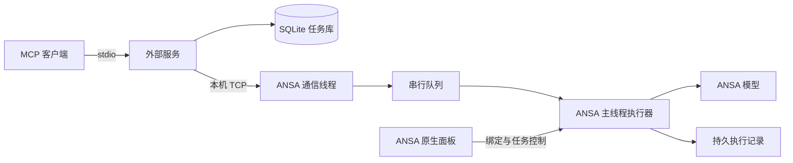

# 架构与执行约束

ANSA MCP Plugin 将外部 MCP 服务与 ANSA 内部执行器分开。生产通信使用带身份校验的本机 TCP；官方 gRPC 只用于隔离测试和独立回读。

## 运行链

## 三个包

| 包 | 职责与依赖 |
| --- | --- |
| `ansa_mcp_plugin` | MCP schema、后端发现与绑定、调度、SQLite 任务状态；在外部 Python 中运行 |
| `ansa_mcp_bridge` | ANSA 通信、主线程执行、模型门禁、操作回读和面板；依赖 ANSA 内置模块、标准库及共享包 |
| `ansa_mcp_shared` | 消息格式、帧、身份、错误与操作分类；只依赖标准库，不反向导入另外两包 |

外部 wheel 包含外部包和共享包；原生 `.bpkg` 包含桥接包、同版共享包和原生入口。`src/` 是两类产物的唯一正式源码来源。

## 目标与模型身份

发现 ANSA 实例只建立通信。用户在目标 ANSA 面板点击连接后，后端才取得活动目标。一个私有运行目录同时只允许一个后端使用。

模型任务携带最近取得的 `expected_target`、`expected_model`。执行前核对实例、会话、目标代次、模型代次、deck 与实体前置条件。New/Open、目标切换或会话重启后，调用方需要重新取得上下文。

当前写入保护限定 ANSA 2026.1.0 GUI、单窗口单模型和已支持的 deck。模型身份无法可靠确认或存在多模型时关闭写入。

`model.write_enabled` 表示通用写入能力；`model.write_tools` 是额外允许的操作列表。LS-DYNA 仅在保留的模型生命周期对象有效时允许质量定位／受控修复，其他写操作继续关闭。共享 `model_write_allowed` 在后端受理及 ANSA 主线程领取时执行相同校验；质量适配器另核实原生模板及 QUAD4／HEXA8 修复范围。

## 线程与写入

所有 ANSA API，包括 GUI 和模型状态探测，均由所属 ANSA 主线程执行。通信线程只接收、校验与排队。执行器有防重入保护；原生模态窗口可能延迟任务执行。

写操作在明确范围内串行执行。需要备份的工具在修改前创建新备份并核验；节点、属性、范围等预期值不匹配时拒绝继续。检查工具保持只读，修复操作须有独立明确契约。

原生 API 不是事务。执行中发生异常时，模型可能已部分修改；错误回包应保留已知实体、阶段与回读信息，不能据失败状态推断模型未变化。

## 持久任务与恢复

- 后端以 SQLite 保存请求、状态和操作键；ANSA 端 Journal 保存任务领取、执行结果及确认信息。
- 同一 `operation_id` 和同一请求复用原任务；同键不同请求会被拒绝。
- 超时、断线或客户端退出不等于 ANSA 已停止执行。先查询原任务与执行记录，再独立回读模型。
- `unknown` 表示结果不确定，不能自动换键重试。取消请求也需要原任务状态确认。
- 后端恢复后的历史查询不会为了补结果重新执行模型操作。

详细状态与接口见[任务、脚本及 API](reference/tasks-api.md)。

## 数据目录

源码、构建暂存和运行控制数据分别管理：

| 目录 | 用途 |
| --- | --- |
| `src/`、`scripts/`、`packaging/` | 实现、构建与安装输入 |
| `tests/` | 回归、集成入口及必要的自制夹具 |
| `build/`、`dist/` | 被忽略的暂存与发行产物 |
| `runtime/verification/` | 被忽略的本机验证报告 |
| 用户私有 `runtime_home` | 认证、发现、任务数据库、Journal 等控制状态 |

控制目录由正式权限检查确认所属用户及防替换能力。源码目录或任意可写目录不能默认视为合格的控制目录。令牌、数据库、官方 SDK、API 缓存和用户模型不进入源码发布。

## 验证层次

离线回归验证 schema 与状态机；模拟 MCP 验证真实 stdio/TCP/SQLite 链路；真机检查验证 ANSA API 效果；保存重开和独立回读核验持久化。图形验收另需确认所属窗口及画布，求解结果也不由这些检查代替。

支持范围见[验证范围](acceptance.md)，开发入口见[开发说明](development.md)。
